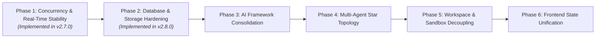
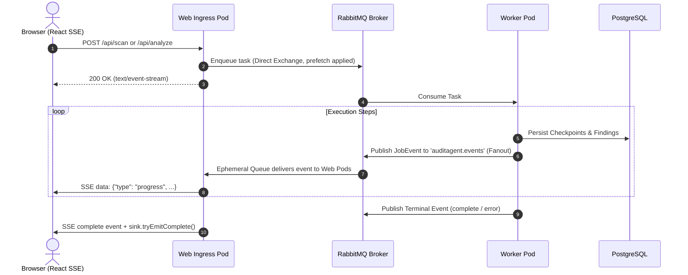
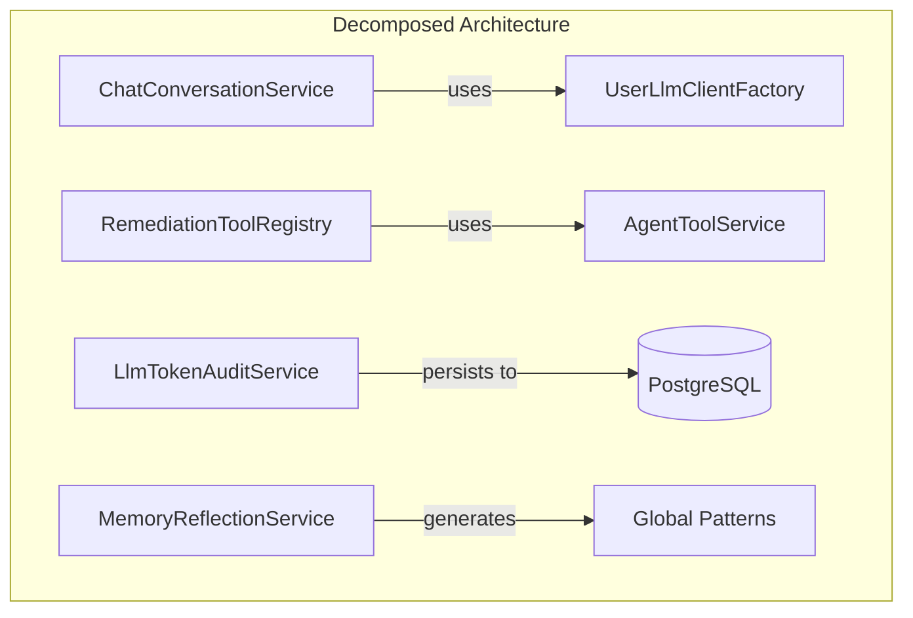
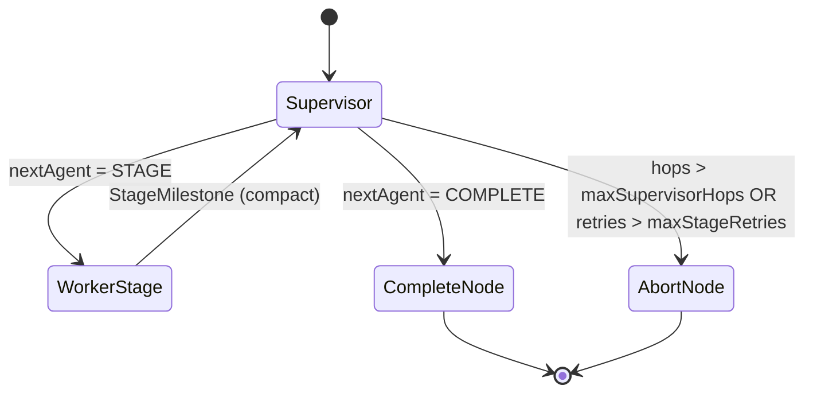
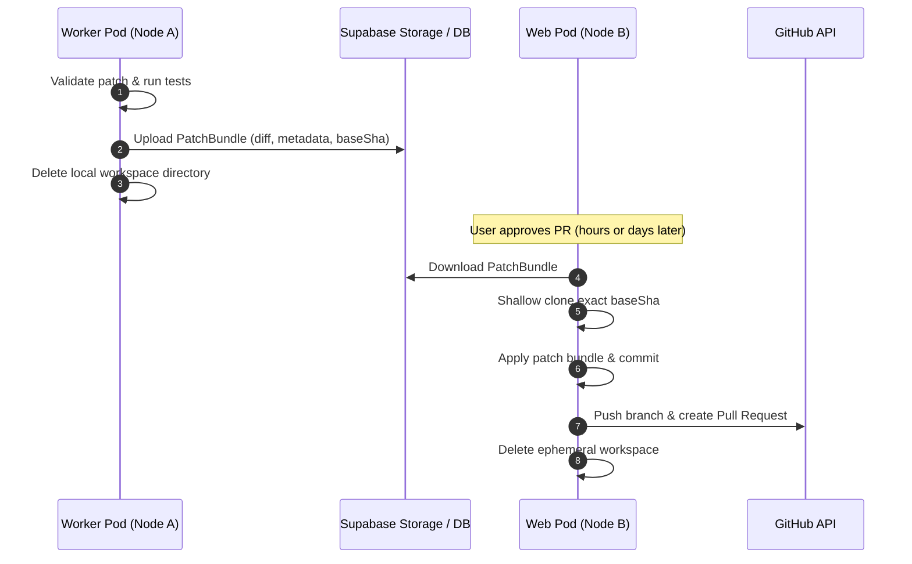
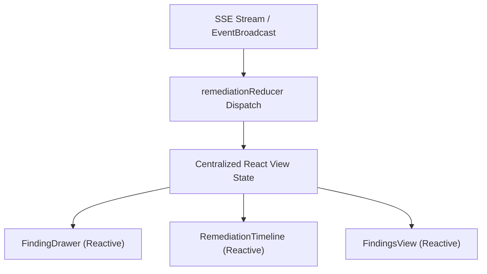

# Scalability, Stability, and Maintainability Roadmap (Phases 1–6)

## Overview

This document specifies the complete, multi-phase architectural roadmap for scaling and hardening **AuditAgent** from a single-node, virtual-thread-bound application to a distributed, horizontally scalable, and maintainable enterprise platform.



### Roadmap Summary

| Phase | Core Objective | Key Architectural Interventions | Status |
| :--- | :--- | :--- | :--- |
| **Phase 1** | **Concurrency & Real-Time Stability** | RabbitMQ `auditagent.events` fanout exchange, striped `ReentrantLock` concurrency, `enqueueAndStreamScan` backpressure, semaphore-bounded triage, LangGraph4j checkpoint scoping. | **Implemented (v2.7.0)** |
| **Phase 2** | **Database & Storage Hardening** | Stored `tsvector` with GIN indexing, bulk finding upserts (eliminating N+1 queries), relational JSON bloat cleanup, real S3/Supabase Storage REST upload client. | **Implemented (v2.8.0)** |
| **Phase 3** | **AI Framework Consolidation** | Standardize exclusively on LangChain4j (deprecating Spring AI duplication), decompose monolithic `LlmService.java` (1,313 lines), unify client caching pools. | **Planned** |
| **Phase 4** | **Multi-Agent Star Topology Hardening** | Structured JSON schema routing for `SupervisorNode`, milestone context window compression, decoupled supervisor iteration budgets from retry limits. | **Planned** |
| **Phase 5** | **Workspace & Sandbox Decoupling** | Stateless workspace reconstruction via patch bundles in object storage, true containerized sandbox execution for untrusted repository builds (`mvn`, `gradle`). | **Planned** |
| **Phase 6** | **Frontend State & Protocol Unification** | Consolidate 12 fragmented `useState` maps in `useRemediationController.js` into a centralized reducer (`useRemediationReducer`), eliminate polling in favor of real-time server push. | **Planned** |

---

## Phase 1: Concurrency and Real-Time Stability *(Implemented in v2.7.0)*

### 1.1 Problem Statement & Objectives
- **Broken Multi-Node Event Streaming:** In-memory `jobSinks` maps caused remote worker progress events to be invisible to web ingress pods serving client Server-Sent Events (SSE) connections.
- **Carrier Thread Pinning:** Method-level and block-level `synchronized` keywords around blocking disk/network I/O in [GitHubAuthService.java](file:///home/coder/workspace/auditagent/src/main/java/com/cb/auditagent/service/GitHubAuthService.java) and [CloneWorkspaceNode.java](file:///home/coder/workspace/auditagent/src/main/java/com/cb/auditagent/graph/workflow/CloneWorkspaceNode.java) pinned Java 21 OS carrier threads.
- **Scan Queue Bypassing:** Primary scan endpoint `POST /api/scan` bypassed RabbitMQ, running CPU-heavy Semgrep AST parsing directly on web pods without backpressure.
- **Unbounded Parallel Triage:** [FindingTriageService.java](file:///home/coder/workspace/auditagent/src/main/java/com/cb/auditagent/service/FindingTriageService.java) launched unbounded virtual threads, triggering `HTTP 429 Too Many Requests` cascades during large scans.
- **Checkpoint Collisions:** Sub-agent executions defaulted to `"default"` `threadId`, causing multi-tenant checkpoint overwrites in PostgreSQL table `graph_checkpoints`.

### 1.2 Architecture & Flow


### 1.3 Implemented Components
1. **RabbitMQ Event Topology**: Declared durable `auditagent.events` fanout exchange in [RabbitMqConfig.java](file:///home/coder/workspace/auditagent/src/main/java/com/cb/auditagent/config/RabbitMqConfig.java) and ephemeral, auto-delete `AnonymousQueue` on web pods.
2. **Striped `ReentrantLock` Striping**: Replaced global `synchronized` locks with identifier-keyed locks (`userId` in `GitHubAuthService` and `repoId:branch:fingerprint` in `CloneWorkspaceNode`), eliminating carrier thread pinning.
3. **Queue-Backed Scans**: Added `enqueueAndStreamScan` in [ScanOrchestratorService.java](file:///home/coder/workspace/auditagent/src/main/java/com/cb/auditagent/service/ScanOrchestratorService.java) and updated [AuditController.java](file:///home/coder/workspace/auditagent/src/main/java/com/cb/auditagent/controller/AuditController.java) with virtual-thread local fallback.
4. **Bounded Triage Concurrency**: Wrapped triage calls in a `Semaphore` (default: 8 permits) with exponential backoff on HTTP 429 errors.
5. **Scoped Checkpoint Keys**: In [MultiAgentRemediationGraph.java](file:///home/coder/workspace/auditagent/src/main/java/com/cb/auditagent/graph/MultiAgentRemediationGraph.java), sub-agent graph executions pass `String.format("%s:%s:%s", threadId, runId, stage.name())`.

### 1.4 Implementation and Verification Checklist (Phase 1)
- [x] **RabbitMQ Event Topology**: Declared `auditagent.events` exchange and ephemeral queue listener in `RabbitMqConfig.java` and `EventBroadcastService.java`.
- [x] **Lock Refactoring**: Replaced `synchronized` in `GitHubAuthService.java` and `CloneWorkspaceNode.java` with identifier-scoped `ReentrantLock` striping.
- [x] **Scan Orchestration**: Implemented `enqueueAndStreamScan` in `ScanOrchestratorService.java` and updated `AuditController.java`.
- [x] **Triage Throttling**: Added `Semaphore` concurrency bounding and 429 backoff retry in `FindingTriageService.java`.
- [x] **Checkpoint Scoping**: Passed scoped `threadId` in `MultiAgentRemediationGraph.java`.
- [x] **Automated Testing**:
  - `GitHubAuthServiceConcurrencyTest`: Verified concurrent access token calls do not block across distinct users.
  - `CloneWorkspaceNodeConcurrencyTest`: Verified parallel remediation startups for distinct findings execute concurrently.
  - `EventBroadcastServiceRabbitMqTest`: Verified cross-pod event publishing routes to local sinks.
  - `FindingTriageConcurrencyTest`: Verified semaphore constraints active HTTP calls under load.
  - Full test suite: 170 tests run, 0 failures, 0 errors, 2 skipped (`BUILD SUCCESS`).
- [x] **Documentation Updates**: Synchronized `doc/03-feature-catalog.md`, `doc/04-architecture.md`, `doc/05-backend-guide.md`, and `doc/18-scalability-and-messaging-architecture.md`.

---

## Phase 2: Database Performance Hardening & Storage Offloading *(Implemented in v2.8.0)*

### 2.1 Problem Statement & Objectives
1. **Unindexed On-The-Fly FTS**: In [PostgresKnowledgeBaseService.java](file:///home/coder/workspace/auditagent/src/main/java/com/cb/auditagent/service/PostgresKnowledgeBaseService.java#L118-L122), queries compute `to_tsvector('english', ...)` dynamically on text strings inside the `WHERE` clause for every row. As approved memories accumulate, every search incurs a high-CPU sequential table scan.
2. **N+1 Finding Persistence**: In [ScanDataService.java](file:///home/coder/workspace/auditagent/src/main/java/com/cb/auditagent/service/data/ScanDataService.java#L150-L181), saving a scan iterates over findings sequentially, executing an individual `SELECT` (`findFirstByRepoPathAndFindingFingerprint`) and individual `save()` per finding (2,000+ DB queries for a 1,000-finding scan).
3. **Relational Table Bloat**: Finding details are duplicated: stored once as relational rows in `vulnerabilities` and once stringified inside `reports.findings_json`.
4. **Stubbed Storage Service**: [SupabaseStorageService.java](file:///home/coder/workspace/auditagent/src/main/java/com/cb/auditagent/service/storage/SupabaseStorageService.java#L68) currently logs a comment (`// Future HTTP client call...`) and falls back to writing files to the local node filesystem, defeating multi-pod artifact access.

### 2.2 Technical Design

#### 1. Generated `search_vector` Column with GIN Index
Update PostgreSQL schema for `repository_memories` to store pre-computed lexemes:
```sql
ALTER TABLE repository_memories 
ADD COLUMN IF NOT EXISTS search_vector tsvector 
GENERATED ALWAYS AS (
    to_tsvector('english', 
        coalesce(title, '') || ' ' || 
        coalesce(summary, '') || ' ' || 
        coalesce(root_cause, '') || ' ' || 
        coalesce(remediation_pattern, '') || ' ' || 
        coalesce(search_text, '')
    )
) STORED;

CREATE INDEX IF NOT EXISTS idx_repo_memories_search_vector 
ON repository_memories USING GIN(search_vector);
```
In `PostgresKnowledgeBaseService.java`, simplify candidate retrieval to:
```sql
SELECT memory_id, repo_path, finding_fingerprint, rule_id, category, ...
FROM repository_memories 
WHERE repo_path = ? AND approved = ? AND search_vector @@ plainto_tsquery('english', ?)
ORDER BY ts_rank_cd(search_vector, plainto_tsquery('english', ?)) DESC 
LIMIT ?;
```

#### 2. Native PostgreSQL Batch Finding Upsert
Replace iterative `save()` in `ScanDataService.java` with Spring `JdbcTemplate.batchUpdate` or native PostgreSQL bulk upsert:
```sql
INSERT INTO vulnerabilities (id, repo_path, file_path, line_number, severity, vuln_type, description, code_snippet, language, proposed_fix, status, rule_id, finding_fingerprint, triage_actionable, triage_confidence, triage_classification, created_at)
VALUES (?, ?, ?, ?, ?, ?, ?, ?, ?, ?, ?, ?, ?, ?, ?, ?, ?)
ON CONFLICT (id) DO UPDATE SET
    severity = EXCLUDED.severity,
    status = EXCLUDED.status,
    proposed_fix = EXCLUDED.proposed_fix,
    triage_actionable = EXCLUDED.triage_actionable,
    triage_confidence = EXCLUDED.triage_confidence,
    triage_classification = EXCLUDED.triage_classification;
```

#### 3. Real Supabase / S3 Storage Upload Client
Implement reactive HTTP uploads via Spring `WebClient` in `SupabaseStorageService.java`:
```java
public String uploadBinaryArtifact(String objectPath, byte[] data) {
    if (isRemoteStorageConfigured()) {
        webClient.post()
            .uri("/storage/v1/object/{bucket}/{path}", bucketName, objectPath)
            .header(HttpHeaders.AUTHORIZATION, "Bearer " + serviceKey)
            .contentType(MediaType.APPLICATION_OCTET_STREAM)
            .bodyValue(data)
            .retrieve()
            .toBodilessEntity()
            .block(Duration.ofSeconds(15));
        return "storage://" + bucketName + "/" + objectPath;
    }
    return saveToLocalFallback(objectPath, data);
}
```

### 2.3 Configuration Additions
```yaml
auditagent:
  database:
    batch-size: ${AUDITAGENT_DB_BATCH_SIZE:100}
  supabase:
    storage:
      enabled: ${AUDITAGENT_STORAGE_REMOTE_ENABLED:true}
      timeout-seconds: 30
```

### 2.4 Implementation and Verification Checklist (Phase 2)
- [x] **Database Migration**: Added `search_vector tsvector GENERATED ALWAYS AS ... STORED` column and GIN index to `repository_memories` via `PostgresSchemaMigrationService.java`.
- [x] **FTS Query Refactoring**: Updated `PostgresKnowledgeBaseService.java` to query pre-indexed `search_vector` column with `ts_rank_cd(search_vector, ...)` instead of calculating `to_tsvector` dynamically in the `WHERE` clause, with graceful fallback.
- [x] **Bulk Upsert Ingestion**: Implemented native batch upsert in `ScanDataService.java` using `JdbcTemplate.batchUpdate` with PostgreSQL `ON CONFLICT (id) DO UPDATE SET ...` (and H2 `MERGE INTO` compatibility for test execution) to eliminate N+1 round trips during scan ingestion.
- [x] **JSON Bloat Elimination**: Deprecated duplicated `reports.findings_json` column (persisted as `null`); load findings lazily/transparently from normalized `vulnerabilities` table with legacy fallback.
- [x] **Supabase Storage REST Client**: Implemented real HTTP upload and download methods in `SupabaseStorageService.java` using Spring `WebClient.Builder`, supporting unified diffs, SARIF dumps, and text/binary artifacts with bearer token auth and local filesystem fallback.
- [x] **Automated Testing**:
  - `PostgresKnowledgeBaseFtsPerformanceTest`: Verifies FTS candidate ranking, exact fingerprint matching priority, negative memory retrieval, and idempotent schema migration.
  - `ScanDataServiceBatchUpsertTest`: Verifies 1,000 findings persist cleanly, `reports.findings_json` is null, findings load transparently from normalized table, and status/fixes are preserved across rescans.
  - `SupabaseStorageClientTest`: WireMock standalone test verifying REST payload, bearer authorization headers, HTTP 500 fallback, and disabled remote storage fallback to local disk.

---

## Phase 3: AI Framework Consolidation & Pipeline Decomposition

### 3.1 Problem Statement & Objectives
1. **Framework Fragmentation**: The application imports Spring AI (`ChatModel`), LangChain4j (`ChatModel`), official OpenAI Java SDK (`OpenAIClient`), and raw Spring `WebClient` simultaneously.
2. **Dual Caching Pools**: [UserLlmClientFactory.java](file:///home/coder/workspace/auditagent/src/main/java/com/cb/auditagent/service/UserLlmClientFactory.java) maintains two parallel caches: `agentModelCache` and `springChatModelCache`.
3. **Monolithic Service Violating SRP**: [LlmService.java](file:///home/coder/workspace/auditagent/src/main/java/com/cb/auditagent/service/LlmService.java) (1,313 lines) bundles chat endpoints, tool specifications, execution dispatching, token auditing, run checkpoints, and reflection summaries.

### 3.2 Technical Design

#### 1. Standardization on LangChain4j
- Migrate all chat conversations ([`LlmService.chat()`](file:///home/coder/workspace/auditagent/src/main/java/com/cb/auditagent/service/LlmService.java#L1030)) from Spring AI to LangChain4j `ChatModel`.
- Remove `spring-ai-openai-spring-boot-starter` from `pom.xml`, removing redundant dependency trees and eliminating split configuration keys.

#### 2. Decomposition of `LlmService.java`
Extract focused domain services:
```text
LlmService.java (1,313 lines)
    ├── ChatConversationService.java       (Handles chat intent matching, user dialogue)
    ├── RemediationToolRegistry.java       (LangChain4j tool specifications, schema, invocation)
    ├── LlmTokenAuditService.java          (Token recording, usage quotas, metrics)
    └── MemoryReflectionService.java       (Diff summarization, global positive/negative patterns)
```



### 3.3 Configuration Consolidation
Consolidate all LLM configuration strictly under `auditagent.llm.*`:
```yaml
auditagent:
  llm:
    provider: openai-compatible
    base-url: ${OPENAI_BASE_URL:https://openrouter.ai/api/v1}
    api-key: ${OPENAI_API_KEY}
    model-name: ${PROVIDER_MODEL:z-ai/glm-5.3-flash}
    supervisor-model-name: ${SUPERVISOR_MODEL_NAME:z-ai/glm-5.3-flash}
```

### 3.4 Implementation and Verification Checklist (Phase 3)
- [ ] **LangChain4j Chat Migration**: Migrate `LlmService.chat()` and `chatStream()` from Spring AI to LangChain4j `ChatModel`.
- [ ] **Dependency Pruning**: Remove `spring-ai-openai-spring-boot-starter` and obsolete Spring AI configuration classes from `pom.xml`.
- [ ] **Service Decomposition**:
  - Extract `ChatConversationService.java` for interactive chat and tag parsing (`[TRIGGER_FIX]`, `[TRIGGER_SCAN]`).
  - Extract `RemediationToolRegistry.java` for tool specifications, permission filtering, and execution dispatching.
  - Extract `MemoryReflectionService.java` for failure/success pattern diff summaries.
- [ ] **Unified Client Factory**: Refactor `UserLlmClientFactory.java` to maintain a single model cache (`Map<String, dev.langchain4j.model.chat.ChatModel>`).
- [ ] **Automated Testing**:
  - `ChatConversationServiceTest`: Verify tag detection and prompt formatting using LangChain4j test doubles.
  - `RemediationToolRegistryTest`: Verify strict tool validation and error serialization.
  - Regression test: Full suite passes with zero Spring AI classes on classpath.

---

## Phase 4: Multi-Agent Star Topology & Supervisor Hardening

### 4.1 Problem Statement & Objectives
1. **Fragile String Matching**: [SupervisorNode.java](file:///home/coder/workspace/auditagent/src/main/java/com/cb/auditagent/graph/node/SupervisorNode.java#L166-L177) expects the LLM to reply with a raw enum name (`"Reply ONLY with the exact name..."`). Markdown, punctuation, or lowercase text causes fallback to `FAIL`.
2. **Quadratic Token Context Expansion**: `SupervisorNode` concatenates uncompressed outputs from all previous stages into `contextStr` on every hop, inflating prompt tokens quadratically.
3. **Execution Limit Conflict**: `auditagent.agent.max-iterations: 5` terminates supervisor execution with `FAIL` on iteration 5, making it impossible to complete a 17-stage workflow.

### 4.2 Technical Design

#### 1. Structured JSON Output for Supervisor Routing
Enforce structured JSON output with enum schema:
```json
{
  "nextAgent": "DISCOVERY",
  "reasoning": "Baseline tests passed; inspecting affected repository files for root cause."
}
```
In `SupervisorNode.java`:
```java
ChatRequest request = ChatRequest.builder()
        .messages(systemMessage, userMessage)
        .responseFormat(ResponseFormat.JSON)
        .build();

SupervisorDecision decision = objectMapper.readValue(
        response.aiMessage().text(), SupervisorDecision.class);
```

#### 2. Milestone-Based Context Summarization
Instead of raw tool and stage dumps, each worker agent persists a compact `StageMilestone`:
```java
public record StageMilestone(
    AgentStage stage, 
    boolean success, 
    String summary, 
    List<String> touchedFiles
) {}
```
The supervisor receives only structured milestones (capped at 150 tokens per stage) rather than entire execution transcripts.

#### 3. Decoupling Hop Limits from Failure Limits
Split `maxIterations` into two independent configuration properties:
- `max-supervisor-hops: 25` (allows navigating through all required review stages)
- `max-stage-retries: 3` (terminates only if a single worker stage fails repeatedly)



### 4.3 Configuration Additions
```yaml
auditagent:
  agent:
    max-supervisor-hops: ${AUDITAGENT_SUPERVISOR_MAX_HOPS:25}
    max-stage-retries: ${AUDITAGENT_STAGE_MAX_RETRIES:3}
    structured-supervisor: true
```

### 4.4 Implementation and Verification Checklist (Phase 4)
- [ ] **Structured Routing**: Refactor `SupervisorNode.java` to use structured JSON output with `SupervisorDecision` DTO.
- [ ] **Enum Resilience**: Add fuzzy enum normalization (strip markdown, case-insensitive match) before falling back to `FAIL`.
- [ ] **Milestone Summarization**: Update `WorkerAgentGraphFactory.java` so completed stages append structured `StageMilestone` objects to state rather than raw string blobs.
- [ ] **Decoupled Hop Limits**: Introduce `max-supervisor-hops` (default: 25) independent of `max-stage-retries` (default: 3) in `AgentConfig.java` and `SupervisorNode.java`.
- [ ] **Automated Testing**:
  - `SupervisorNodeStructuredTest`: Verify model JSON response deserialization and validation.
  - `SupervisorContextCompressionTest`: Verify supervisor prompt tokens remain $O(N)$ with compact milestones rather than $O(N^2)$.
  - `MultiAgentExecutionLimitTest`: Verify graph safely executes 10+ consecutive stages without hitting premature iteration aborts.

---

## Phase 5: Workspace Storage Decoupling & Host Sandbox Hardening

### 5.1 Problem Statement & Objectives
1. **Node-Local Workspace Dependency**: [PublicationNode.java](file:///home/coder/workspace/auditagent/src/main/java/com/cb/auditagent/graph/workflow/PublicationNode.java#L80) reads `publication.workspacePath()` directly from the local filesystem. In a multi-pod cluster, if approval happens on a pod different from the worker, the directory does not exist.
2. **Host OS Execution of Untrusted Builds**: Default `auditagent.agent.sandbox-enabled: false` runs `mvn test`, `gradle test`, and build scripts directly on the host JVM container OS with host privileges.

### 5.2 Technical Design

#### 1. Stateless Patch Bundles in Object Storage
- When remediation passes validation on a worker pod, serialize the patch bundle (`git diff` and changed file list) and upload it to Supabase Storage / PostgreSQL `run_changes`.
- Clean up the local clone immediately on the worker node.
- When the user approves the PR (`POST /api/runs/{runId}/decision`), `PublicationNode` downloads the patch bundle, clones a clean workspace at `baseSha`, applies the patch, commits, and pushes to GitHub.



#### 2. Ephemeral Containerized Sandbox Execution
When `auditagent.agent.sandbox-enabled: true`:
- Replace native `ProcessBuilder` with an ephemeral container runner (Docker-in-Docker or Kubernetes ephemeral Pod runner).
- Mount workspace read-only except for target build directories.
- Apply strict resource quotas:
  - CPU Limit: 2.0 cores
  - Memory Limit: 2 GB
  - Network: Restricted (offline builds or internal proxy only)
  - Dropped Linux capabilities (`CAP_NET_RAW`, `CAP_SYS_ADMIN`).

### 5.3 Configuration Additions
```yaml
auditagent:
  agent:
    sandbox-enabled: ${AUDITAGENT_SANDBOX_ENABLED:true}
    sandbox-image: ${AUDITAGENT_SANDBOX_IMAGE:auditagent-sandbox:2.7.0}
    sandbox-memory-limit: ${AUDITAGENT_SANDBOX_MEMORY:2g}
    sandbox-cpu-limit: ${AUDITAGENT_SANDBOX_CPU:2.0}
    stateless-workspaces: ${AUDITAGENT_STATELESS_WORKSPACES:true}
```

### 5.4 Implementation and Verification Checklist (Phase 5)
- [ ] **Patch Bundle Persistence**: Implement `PatchBundleService` to serialize, upload, and download verified unified diffs and file change manifests.
- [ ] **Stateless Publication**: Refactor `PublicationNode.java` to reconstruct workspaces from patch bundles at publish time, removing reliance on `run_publications.workspace_path` persistence across nodes.
- [ ] **Workspace Lifecycle Cleanup**: Ensure scan and remediation workspaces are deleted immediately upon task completion or failure.
- [ ] **Containerized Process Runner**: Implement `ContainerizedProcessRunner.java` implementing `ManagedProcessRunner` with Docker/container CLI abstraction when sandbox is enabled.
- [ ] **Automated Testing**:
  - `StatelessPublicationTest`: Remediate on Node A double, publish on Node B double using only remote patch bundle.
  - `ContainerizedSandboxSecurityTest`: Verify environment variables, host filesystem boundaries, and resource limits inside sandbox containers.

---

## Phase 6: Frontend State Decomposition & Protocol Unification

### 6.1 Problem Statement & Objectives
1. **State Fragmentation in `useRemediationController.js` (688 lines)**: State is scattered across 12 distinct `useState` maps keyed by `vulnId` (`runs`, `publications`, `previews`, `isAnalyzingMap`, `isPublishingMap`, `isLoadingPreviewMap`, `isLoadingRunMap`, etc.).
2. **Imperative Data Normalization**: Manual snake_case and camelCase field checks (`run.vulnerabilityId = run.vulnerability_id`) cause race conditions during rapid user tab switching.
3. **Redundant HTTP Polling**: The frontend uses polling intervals to check PR status (`PR_OPEN`, `AWAITING_APPROVAL`) instead of reacting to server-pushed events.

### 6.2 Technical Design

#### 1. Reducer Architecture (`useRemediationReducer`)
Consolidate 12 state maps into a single domain state model:
```javascript
const initialState = {
  selectedFindingId: null,
  remediations: {
    // [vulnId]: { status, run, publication, preview, isAnalyzing, isPublishing, error, graphSteps }
  },
  batch: null
};

function remediationReducer(state, action) {
  switch (action.type) {
    case 'ANALYSIS_STARTED': ...
    case 'GRAPH_STEP_UPDATED': ...
    case 'APPROVAL_READY': ...
    case 'PUBLISH_STARTED': ...
    case 'PR_CREATED': ...
    case 'REMEDIATION_FAILED': ...
    default: return state;
  }
}
```

#### 2. Real-Time Push Event Subscriptions
- Eliminate background polling loops in `useRemediationController.js`.
- Leverage Phase 1's RabbitMQ event stream to receive terminal events (`pr_created`, `complete`, `error`) and dispatch directly to `remediationReducer`.



### 6.3 Implementation and Verification Checklist (Phase 6)
- [ ] **Reducer Refactoring**: Extract `useRemediationReducer.js` and migrate state from 12 separate `useState` hooks.
- [ ] **Eliminate Polling**: Remove `setInterval` polling loops for `PR_OPEN` and `AWAITING_APPROVAL` in favor of SSE terminal event handling.
- [ ] **Contract Normalization**: Implement strict TypeScript/JSDoc types for SSE payloads in `frontend/src/types.js`.
- [ ] **Automated Testing**:
  - `useRemediationReducer.test.js`: Unit tests for every state transition and error condition.
  - `FindingDrawer.test.jsx`: Component test verifying timeline updates reactively without polling.
  - End-to-end Vitest run: All frontend tests pass (`npm test`).

---

## Complete Multi-Phase Verification & Execution Checklist

| Phase | Milestone | Primary Verification Gate | Status |
| :---: | :--- | :--- | :---: |
| **Phase 1** | **Concurrency & Real-Time Stability** | RabbitMQ cross-pod event SSE test + non-blocking virtual thread lock tests. | **[x] Implemented** |
| **Phase 2** | **Database & Storage Hardening** | GIN `search_vector` FTS ranking + bulk batch upsert test ($<500\text{ms}$) + WireMock storage test. | **[x] Implemented (v2.8.0)** |
| **Phase 3** | **AI Framework Consolidation** | Complete removal of Spring AI dependencies + decomposed `LlmService` unit tests. | **[ ] Planned** |
| **Phase 4** | **Multi-Agent Star Topology** | Structured JSON schema supervisor test + token budget verification across 10+ hops. | **[ ] Planned** |
| **Phase 5** | **Workspace & Sandbox Decoupling** | Stateless patch bundle PR publication test + container resource limit enforcement. | **[ ] Planned** |
| **Phase 6** | **Frontend State Unification** | Vitest suite verifying reducer state transitions without polling intervals. | **[ ] Planned** |
