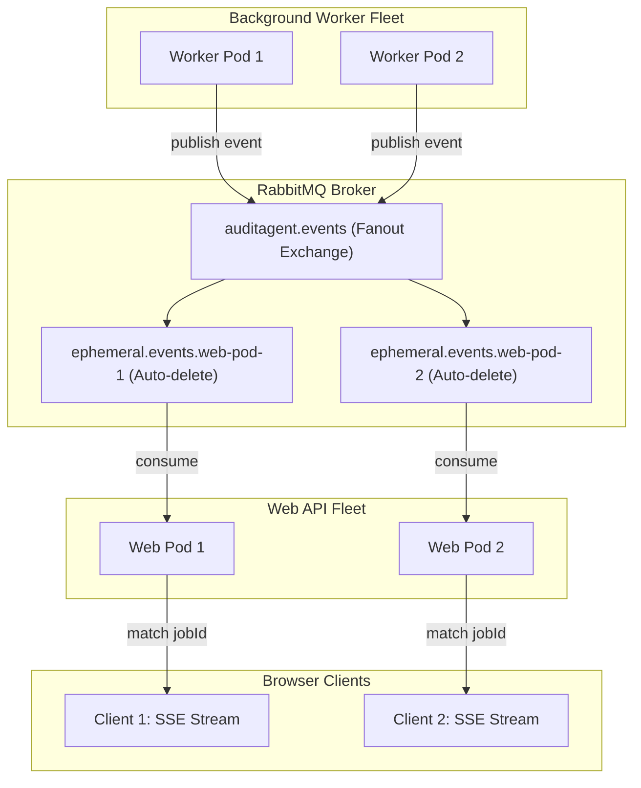
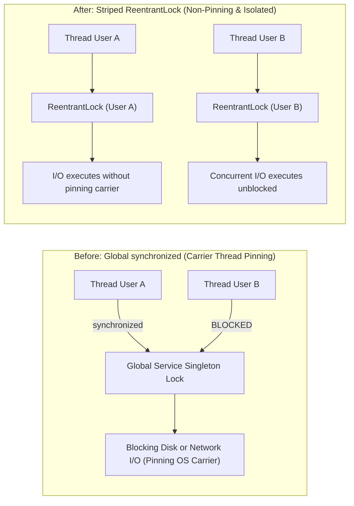
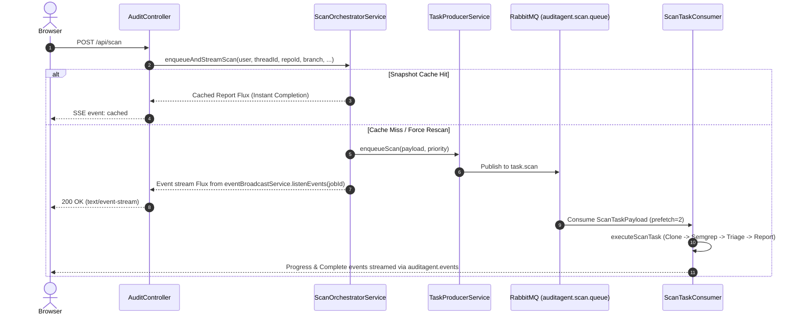

# Concurrency and real-time stability plan

## Overview

This document specifies the architectural implementation plan for **Phase 1: Concurrency and Real-Time Stability** of AuditAgent. It addresses the core operational bottlenecks identified during the scalability and maintainability architecture review, establishing reliable multi-pod task and event processing, eliminating Java 21 virtual-thread carrier pinning, and preventing rate-limiting failures during large static analysis scans.

```text
Browser (React SSE Client)
    | HTTP POST /api/scan or /api/analyze
    v
Web Ingress Pods (auditagent.mode=web|all)
    | generates jobId, registers local jobSinks
    +--> RabbitMQ Task Queues (auditagent.direct)
           |
           v
Worker Pods (auditagent.mode=worker|all)
    | executes Semgrep scan or LangGraph4j remediation
    +--> PostgreSQL (Checkpoints, findings, logs)
    +--> RabbitMQ Event Exchange (auditagent.events Fanout/Topic)
           |
           +--> Ephemeral Web Pod Queues (Exclusive, Auto-delete)
                  |
                  v
                Web Ingress Pods -> SSE Stream -> Browser UI
```

---

## 1. Architectural objectives and motivation

### Bottlenecks resolved

1. **Broken multi-node event streaming:** [EventBroadcastService.java](file:///home/coder/workspace/auditagent/src/main/java/com/cb/auditagent/service/realtime/EventBroadcastService.java) previously stored event listeners exclusively in an in-memory `ConcurrentHashMap<String, Sinks.Many<String>> jobSinks`. In a multi-pod cluster, events emitted by a background worker pod were invisible to the web pod serving the client's Server-Sent Events (SSE) connection, leaving the client waiting indefinitely on keepalive pulses.
2. **Java 21 carrier-thread pinning from global synchronized locks:** Method-level and block-level `synchronized` keywords around blocking I/O (such as disk cleanup in [CloneWorkspaceNode.java](file:///home/coder/workspace/auditagent/src/main/java/com/cb/auditagent/graph/workflow/CloneWorkspaceNode.java) and external GitHub OAuth network refreshes in [GitHubAuthService.java](file:///home/coder/workspace/auditagent/src/main/java/com/cb/auditagent/service/GitHubAuthService.java)) pinned underlying operating system carrier threads, degrading JVM throughput and stalling unrelated user requests.
3. **Queue bypassing on repository scans:** The primary scan endpoint `POST /api/scan` bypassed the RabbitMQ task queue, running CPU-intensive Semgrep AST scans directly inside local virtual threads on the web pod. This bypassed configured concurrency limits (`prefetch = 2`), exposing ingress nodes to memory exhaustion.
4. **Unbounded parallel triage bursts:** [FindingTriageService.java](file:///home/coder/workspace/auditagent/src/main/java/com/cb/auditagent/service/FindingTriageService.java) spawned unbounded virtual threads to triage findings against LLM endpoints simultaneously. On repositories with hundreds of findings, this caused immediate `HTTP 429 Too Many Requests` cascades and socket starvation.
5. **Multi-tenant checkpoint collisions:** [MultiAgentRemediationGraph.java](file:///home/coder/workspace/auditagent/src/main/java/com/cb/auditagent/graph/MultiAgentRemediationGraph.java) invoked worker sub-graphs without an explicit `threadId`, defaulting checkpoints to `"default"` in PostgreSQL and causing state collisions across concurrent runs.

---

## 2. RabbitMQ cross-pod event pipeline

### Topology and message routing

To distribute lifecycle events from any worker pod to the specific web pod holding the client's open HTTP SSE connection without requiring extra infrastructure, the architecture introduces the `auditagent.events` exchange.



### Component specification

1. **Exchange declaration** in [RabbitMqConfig.java](file:///home/coder/workspace/auditagent/src/main/java/com/cb/auditagent/config/RabbitMqConfig.java):
   - Name: `auditagent.events`
   - Type: `FanoutExchange` (durable: `true`, autoDelete: `false`)
2. **Ephemeral ingress queues**:
   - Each web ingress node declares an ephemeral, exclusive, auto-delete queue on startup:
     ```java
     Queue ingressQueue = new AnonymousQueue();
     Binding binding = BindingBuilder.bind(ingressQueue).to(eventsExchange);
     ```
   - When a web pod shuts down or is terminated, its ephemeral queue is automatically deleted by RabbitMQ.
3. **Event publishing**:
   - `EventBroadcastService.broadcastEvent(jobId, runId, eventType, payload)` continues persisting to PostgreSQL `job_event_log` for auditing, and publishes the serialized event payload to `auditagent.events` using `RabbitTemplate`.
4. **Event dispatching on web nodes**:
   - The `@RabbitListener` on the web pod inspects the incoming `jobId`.
   - If `jobSinks.containsKey(jobId)`, the JSON payload is emitted to the local Reactor `Sink`.
   - If `jobId` does not exist on this node (belonging to a client on another web pod), the message is dropped in $O(1)$ without error.
5. **Standalone / local fallback**:
   - If RabbitMQ is disabled or unconfigured (`auditagent.worker.enabled=false`), `EventBroadcastService` falls back to direct local `jobSinks` emission.

---

## 3. Striped ReentrantLock concurrency model

### Elimination of carrier-thread pinning

Java 21 virtual threads run on top of a pool of OS carrier threads (typically equal to the number of CPU cores). When code inside a `synchronized` block executes a blocking system call (disk deletion, socket read, or network I/O), the virtual thread cannot unmount and pins the carrier thread.



### 1. `GitHubAuthService` token refresh

- **Previous implementation:** Method-level `public synchronized String accessToken(String userId)` globally blocked all users while executing an HTTP code exchange with GitHub.
- **New implementation:** An identifier-striped `ReentrantLock` keyed by `userId`:
  ```java
  private final ConcurrentHashMap<String, ReentrantLock> userAuthLocks = new ConcurrentHashMap<>();

  public String accessToken(String userId) {
      ReentrantLock lock = userAuthLocks.computeIfAbsent(userId, k -> new ReentrantLock());
      lock.lock();
      try {
          // 1. Re-check expiry inside lock (double-checked)
          // 2. Refresh via GitHubApiClient if expired
          // 3. Persist new tokens and return plaintext
      } finally {
          lock.unlock();
      }
  }
  ```
- **Operational impact:** Token refreshes for User A no longer block token retrieval for User B. `ReentrantLock` allows Java 21 virtual threads to unmount from carrier threads during blocking HTTP calls.

### 2. `CloneWorkspaceNode` workspace preparation

- **Previous implementation:** `synchronized (database)` locked the singleton `DatabaseService` across the JVM while running recursive directory deletions (`sourceControl.cleanupWorkspace`) and multiple database queries.
- **New implementation:** Scoped lock keyed by finding key:
  ```java
  String lockKey = repositoryId + ":" + branch + ":" + fingerprint;
  ReentrantLock lock = findingPreparationLocks.computeIfAbsent(lockKey, k -> new ReentrantLock());
  lock.lock();
  try {
      // 1. Identify previous active runs for this exact finding
      // 2. Discard stale runs and clean prior workspace paths
      // 3. Initialize fresh AgentRunRecord
  } finally {
      lock.unlock();
  }
  ```
- **Operational impact:** Concurrency is serialized only for the exact same finding in the same repository branch. Unrelated findings and repositories run concurrently without blocking.

---

## 4. Scan queue alignment (`enqueueAndStreamScan`)

### Unified async execution pattern

Both repository scanning and vulnerability remediation follow the unified `enqueueAndStream` execution pattern:



### Error handling and fallback

If RabbitMQ is unavailable, connection fails, or `taskProducerService` is unconfigured:
1. The service logs a warning: `TaskProducerService not available; executing scan task [{}] locally`.
2. It launches `Thread.startVirtualThread(() -> executeScanTask(payload))` to maintain standalone developer workflow.
3. The client receives the identical SSE event stream transparently.

---

## 5. Bounded concurrency in finding triage

### Semaphore bounding and exponential backoff

During static analysis, Semgrep can generate hundreds of findings. [FindingTriageService.java](file:///home/coder/workspace/auditagent/src/main/java/com/cb/auditagent/service/FindingTriageService.java) is enhanced with bounded concurrency and resilience against rate limits:

1. **Configurable concurrency:** Added `auditagent.jev.triage.concurrency` (default: 8, range: 1–32) to `application.yaml`.
2. **Semaphore protection:**
   ```java
   private final Semaphore triageSemaphore = new Semaphore(properties.getTriage().getConcurrency());
   ```
3. **Exponential backoff on HTTP 429:**
   If the LLM provider returns `429 Too Many Requests`:
   - Attempt 1: Backoff 500ms + jitter
   - Attempt 2: Backoff 1500ms + jitter
   - Attempt 3: Backoff 3500ms + jitter
   - If retries are exhausted, the finding is retained with default metadata and triage status marked as `UNVERIFIED` rather than failing the entire repository scan.

---

## 6. LangGraph4j checkpoint isolation

### Multi-tenant scoped keys

In [MultiAgentRemediationGraph.java](file:///home/coder/workspace/auditagent/src/main/java/com/cb/auditagent/graph/MultiAgentRemediationGraph.java), sub-agent worker stages previously executed with an empty configuration:

```java
// Before: Collided on "default" threadId in DatabaseCheckpointSaver
RemediationState result = stageGraph.invoke(
        GraphInput.args(subStateMap),
        RunnableConfig.builder().build()
).orElse(...);

// After: Isolated per thread, run, and sub-agent stage
String subThreadId = String.format("%s:%s:%s", threadId, runId, stage.name());
RunnableConfig subConfig = RunnableConfig.builder()
        .threadId(subThreadId)
        .build();
RemediationState result = stageGraph.invoke(
        GraphInput.args(subStateMap),
        subConfig
).orElse(...);
```

Checkpoints in `graph_checkpoints` are strictly namespaced by run and stage, enabling reliable recovery without multi-tenant overwrites.

---

## 7. Configuration parameters

New and adjusted configuration properties in `application.yaml`:

```yaml
auditagent:
  messaging:
    events-exchange: ${AUDITAGENT_EVENTS_EXCHANGE:auditagent.events}
  jev:
    triage:
      enabled: ${AUDITAGENT_JEV_TRIAGE_ENABLED:true}
      concurrency: ${AUDITAGENT_JEV_TRIAGE_CONCURRENCY:8}
      max-retries: 3
      backoff-initial-ms: 500
  scanner:
    queue-priority: ${AUDITAGENT_SCAN_PRIORITY:5}
```

---

## 8. Implementation and verification checklist

- [x] **RabbitMQ Event Topology**: Declare `auditagent.events` exchange and ephemeral queue listener in `RabbitMqConfig.java` and `EventBroadcastService.java`.
- [x] **Lock Refactoring**: Replace `synchronized` in `GitHubAuthService.java` and `CloneWorkspaceNode.java` with identifier-scoped `ReentrantLock` striping.
- [x] **Scan Orchestration**: Implement `enqueueAndStreamScan` in `ScanOrchestratorService.java` and update `AuditController.java`.
- [x] **Triage Throttling**: Add `Semaphore` concurrency bounding and 429 backoff retry in `FindingTriageService.java`.
- [x] **Checkpoint Scoping**: Pass scoped `threadId` in `MultiAgentRemediationGraph.java`.
- [x] **Automated Testing**:
  - `GitHubAuthServiceConcurrencyTest`: Verify concurrent access token calls do not block across distinct users.
  - `CloneWorkspaceNodeConcurrencyTest`: Verify parallel remediation startups for distinct findings execute concurrently.
  - `EventBroadcastServiceRabbitMqTest`: Verify cross-pod event publishing routes to local sinks.
  - `FindingTriageConcurrencyTest`: Verify semaphore constraints active HTTP calls under load.
- [x] **Documentation Updates**: Synchronize `doc/04-architecture.md`, `doc/05-backend-guide.md`, and `doc/18-scalability-and-messaging-architecture.md`.
